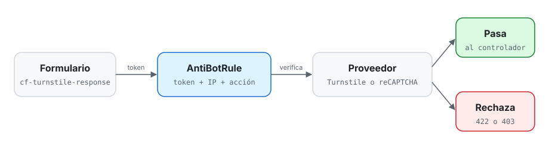

<p align="center">
  <picture>
    <source media="(prefers-color-scheme: dark)" srcset=".github/assets/logo-dark.svg">
    
  </picture>
</p>

<h3 align="center">Protect your forms from bots with a single validation rule</h3>

<p align="center">
  <a href="https://packagist.org/packages/abitechdev/antibot-laravel"></a>
  <a href="https://packagist.org/packages/abitechdev/antibot-laravel"></a>
  <a href="https://github.com/abitech-dev/abitech-antibot-laravel/actions/workflows/ci.yml"></a>
  
  
  <a href="LICENSE"></a>
</p>

<p align="center">
  <a href="#quick-start">Quick start</a> &nbsp;|&nbsp;
  <a href="#usage">Usage</a> &nbsp;|&nbsp;
  <a href="#configuration">Configuration</a> &nbsp;|&nbsp;
  <a href="#in-your-tests">In your tests</a> &nbsp;|&nbsp;
  <a href="README.md">Español</a>
</p>

<br>

Public forms such as sign up, login or contact get automated bot submissions.
**AntiBot** validates on the server the token issued by Cloudflare Turnstile
or Google reCAPTCHA, with the same rule for all three providers. Switching
providers takes one environment variable.

<p align="center">
  <picture>
    <source media="(prefers-color-scheme: dark)" srcset=".github/assets/flujo-dark.svg">
    
  </picture>
</p>

## Quick start

**1. Install the package.** Laravel registers it automatically.

```bash
composer require abitechdev/antibot-laravel
```

**2. Add the secret key** of your provider to `.env`.

```env
ANTIBOT_DEFAULT=turnstile
TURNSTILE_SECRET=your-secret-key
```

**3. Validate the form** with the rule.

```php
use Abitech\AntiBot\Rules\AntiBotRule;

$request->validate([
    'email' => ['required', 'email'],
    'cf-turnstile-response' => ['required', new AntiBotRule()],
]);
```

Done. When the token is not valid, Laravel returns the validation error as it
does for any other rule.

## Features

<table>
  <tr>
    <td width="50%" valign="top">
      <h4>🛡️ One API</h4>
      Turnstile, reCAPTCHA v2 and reCAPTCHA v3 are validated the same way,
      with <code>new AntiBotRule()</code>.
    </td>
    <td width="50%" valign="top">
      <h4>🧩 Rule, middleware or facade</h4>
      Use it where it fits best, without repeating code in every form.
    </td>
  </tr>
  <tr>
    <td valign="top">
      <h4>🎯 Action and score</h4>
      Checks that the token action is the expected one and that reCAPTCHA v3
      passes the minimum score.
    </td>
    <td valign="top">
      <h4>🧪 Easy to test</h4>
      <code>ANTIBOT_ENABLED=false</code> turns verification off locally and in
      automated tests.
    </td>
  </tr>
  <tr>
    <td valign="top">
      <h4>💬 Spanish messages</h4>
      Errors ship translated to Spanish and can be changed by publishing
      their texts.
    </td>
    <td valign="top">
      <h4>✅ Tested from Laravel 8 to 13</h4>
      Continuous integration runs the tests on every version, with its
      minimum PHP.
    </td>
  </tr>
</table>

## Providers

| Provider | `ANTIBOT_DEFAULT` | Checks |
| --- | --- | --- |
|  | `turnstile` | Token and action |
|  | `recaptcha_v2` | Token |
|  | `recaptcha_v3` | Token, action and score |

## Compatibility

| Laravel | Minimum PHP | Status |
| --- | --- | --- |
| 13 | 8.3 | ✅ Tested |
| 12 | 8.2 | ✅ Tested |
| 11 | 8.2 | ✅ Tested |
| 10 | 8.1 | ✅ Tested |
| 9 | 8.0 | ✅ Tested |
| 8 | 7.3 | ✅ Tested |

## Usage

### With the validation rule

The recommended way. It validates the token together with the IP of the
sender. With reCAPTCHA the field is `g-recaptcha-response`.

```php
'g-recaptcha-response' => ['required', new AntiBotRule()],
```

### With the middleware

Protects a whole route. It reads the token from the `X-AntiBot-Token` header
or the `antibot_token` field, and responds 403 when it is not valid.

```php
Route::post('/contact', ContactController::class)->middleware('antibot');
```

### With the facade

To decide in code what to do with the result.

```php
use Abitech\AntiBot\Facades\AntiBot;

$result = AntiBot::verify($token, $request->ip());

if (! $result->success) {
    // $result->errors holds the provider error codes.
}
```

<details>
<summary><strong>Require an action</strong></summary>
<br>

Turnstile and reCAPTCHA v3 attach the action name to the token. When it does
not match the expected one, validation fails, so a token issued for another
form is useless here.

```php
new AntiBotRule('login');                               // In the rule
Route::post('/login', ...)->middleware('antibot:login'); // In the middleware
AntiBot::verify($token, $request->ip(), 'login');       // With the facade
```

</details>

<details>
<summary><strong>Use another provider in one place</strong></summary>
<br>

The default provider comes from `ANTIBOT_DEFAULT`. To use another one in a
specific place, ask for it by name.

```php
AntiBot::driver('recaptcha_v3')->verify($token, $request->ip(), 'newsletter');
```

</details>

## Configuration

Everything is configured through environment variables.

| Variable | Default | Purpose |
| --- | --- | --- |
| `ANTIBOT_ENABLED` | `true` | `false` approves everything without the provider |
| `ANTIBOT_DEFAULT` | `turnstile` | Provider used by the rule and the middleware |
| `TURNSTILE_SECRET` | | Cloudflare Turnstile secret key |
| `RECAPTCHA_V2_SECRET` | | reCAPTCHA v2 secret key |
| `RECAPTCHA_V3_SECRET` | | reCAPTCHA v3 secret key |
| `RECAPTCHA_V3_SCORE` | `0.5` | Minimum reCAPTCHA v3 score, from 0 to 1 |

Each provider also accepts its `*_TIMEOUT`, in seconds (10 by default). To
change anything else, publish the configuration file or the messages:

```bash
php artisan vendor:publish --tag=antibot-config
php artisan vendor:publish --tag=antibot-translations
```

## In your tests

Turn verification off in `phpunit.xml` so tests do not depend on the network.

```xml
<env name="ANTIBOT_ENABLED" value="false"/>
```

To test a rejection, keep the package on and fake the provider response with
`Http::fake()`.

## More

- 📚 [Full guide](docs/1-installation.md), in Spanish, with configuration and
  advanced usage.
- 🔒 [Security policy](SECURITY.md). Vulnerabilities are reported privately.
- 🤝 [Contributing guide](CONTRIBUTING.md). Proposals are welcome.
- 📝 [Changes in each version](CHANGELOG.md).

## License

Released under the [MIT license](LICENSE). You can use, modify and
distribute it, commercial projects included.

<br>

<p align="center">
  Made in Huánuco, Peru, by <a href="https://abitech.dev">Abimael Fernandez</a>
</p>
