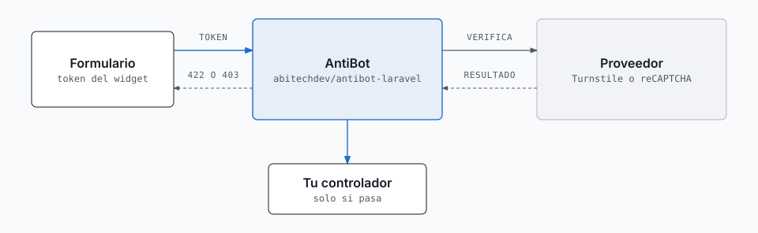

<p align="center">
  <picture>
    <source media="(prefers-color-scheme: dark)" srcset="docs/imagenes/logo-oscuro.svg">
    
  </picture>
</p>

<h1 align="center">AntiBot Laravel</h1>

<p align="center">Protects Laravel forms from bots with Turnstile or reCAPTCHA through a single validation rule</p>

<p align="center">
  <a href="https://packagist.org/packages/abitechdev/antibot-laravel"></a>
  <a href="https://github.com/abitech-dev/abitech-antibot-laravel/actions/workflows/ci.yml"></a>
  
  <a href="LICENSE"></a>
</p>

<p align="center">
  <a href="#quick-start">Quick start</a> &nbsp;|&nbsp;
  <a href="#usage">Usage</a> &nbsp;|&nbsp;
  <a href="#documentation">Documentation</a> &nbsp;|&nbsp;
  <a href="README.md">Español</a>
</p>

<picture>
  <source media="(prefers-color-scheme: dark)" srcset="docs/diagramas/flujo-dark.svg">
  
</picture>

Public forms, such as sign-up, login or contact, receive bot submissions.
AntiBot validates the Cloudflare Turnstile or Google reCAPTCHA token on the
server, and switching providers means changing one environment variable.

## What it does

<table>
  <tr>
    <td width="50%" valign="top">
      <picture><source media="(prefers-color-scheme: dark)" srcset="docs/iconos/proveedores-dark.svg"></picture><br><strong>One rule, three providers</strong><br>Turnstile, reCAPTCHA v2 and v3 are validated the same way, with <code>new AntiBotRule()</code>.
    </td>
    <td width="50%" valign="top">
      <picture><source media="(prefers-color-scheme: dark)" srcset="docs/iconos/formas-dark.svg"></picture><br><strong>Rule, middleware or facade</strong><br>Use it where it fits best, without repeating code in every form.
    </td>
  </tr>
  <tr>
    <td width="50%" valign="top">
      <picture><source media="(prefers-color-scheme: dark)" srcset="docs/iconos/accion-dark.svg"></picture><br><strong>Action and score</strong><br>Checks the token action and the minimum reCAPTCHA v3 score.
    </td>
    <td width="50%" valign="top">
      <picture><source media="(prefers-color-scheme: dark)" srcset="docs/iconos/pruebas-dark.svg"></picture><br><strong>Easy to test</strong><br><code>ANTIBOT_ENABLED=false</code> turns verification off locally and in tests.
    </td>
  </tr>
  <tr>
    <td width="50%" valign="top">
      <picture><source media="(prefers-color-scheme: dark)" srcset="docs/iconos/mensajes-dark.svg"></picture><br><strong>Translated messages</strong><br>Errors come translated and their texts can be published to change them.
    </td>
    <td width="50%" valign="top">
      <picture><source media="(prefers-color-scheme: dark)" srcset="docs/iconos/versiones-dark.svg"></picture><br><strong>Laravel 8 to 13</strong><br>Continuous integration tests every version with its minimum PHP.
    </td>
  </tr>
</table>

## Quick start

```bash
composer require abitechdev/antibot-laravel
```

```env
ANTIBOT_DEFAULT=turnstile
TURNSTILE_SECRET=your-secret-key
```

```php
use Abitech\AntiBot\Rules\AntiBotRule;

$request->validate([
    'email' => ['required', 'email'],
    'cf-turnstile-response' => ['required', new AntiBotRule()],
]);
```

If the token is not valid, Laravel returns the validation error like any other
rule.

## Usage

| Provider | `ANTIBOT_DEFAULT` | Checks |
| --- | --- | --- |
| Cloudflare Turnstile | `turnstile` | Token and action |
| reCAPTCHA v2 | `recaptcha_v2` | Token |
| reCAPTCHA v3 | `recaptcha_v3` | Token, action and score |

The middleware protects a whole route and answers 403 if the token is not
valid:

```php
Route::post('/contact', ContactController::class)->middleware('antibot');
```

The facade lets the code decide, also with an expected action:

```php
$result = AntiBot::verify($token, $request->ip(), 'login');
```

## Compatibility

| Laravel | PHP |
| --- | --- |
| 13 | 8.3 |
| 12 | 8.2 |
| 11 | 8.2 |
| 10 | 8.1 |
| 9 | 8.0 |
| 8 | 7.3 |

## Documentation

| I want to… | Document (Spanish) |
| --- | --- |
| Install it step by step | [1-installation.md](docs/1-installation.md) |
| See every variable | [2-configuration.md](docs/2-configuration.md) |
| Use the rule, middleware or facade | [3-usage.md](docs/3-usage.md) |
| Require actions or switch providers | [4-advanced.md](docs/4-advanced.md) |
| See changes by version | [CHANGELOG.md](CHANGELOG.md) |

## Contributing

The steps and what continuous integration checks are in
[CONTRIBUTING.md](CONTRIBUTING.md). To report a vulnerability, follow
[SECURITY.md](SECURITY.md).

## License

Copyright © 2026 ABItech Perú. MIT license, see [LICENSE](LICENSE).
