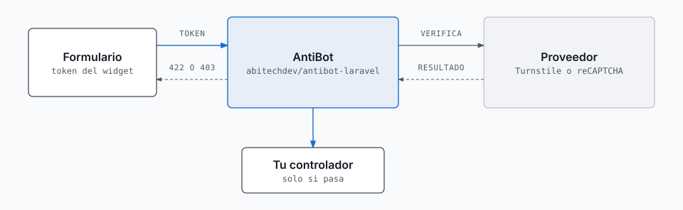

<p align="center">
  <picture>
    <source media="(prefers-color-scheme: dark)" srcset="docs/imagenes/logo-oscuro.svg">
    
  </picture>
</p>

<h1 align="center">AntiBot Laravel</h1>

<p align="center">Protege los formularios de Laravel contra bots con Turnstile o reCAPTCHA desde una sola regla de validación</p>

<p align="center">
  <a href="https://packagist.org/packages/abitechdev/antibot-laravel"></a>
  <a href="https://github.com/abitech-dev/abitech-antibot-laravel/actions/workflows/ci.yml"></a>
  
  <a href="LICENSE"></a>
</p>

<p align="center">
  <a href="#inicio-rápido">Inicio rápido</a> &nbsp;|&nbsp;
  <a href="#uso">Uso</a> &nbsp;|&nbsp;
  <a href="#documentación">Documentación</a> &nbsp;|&nbsp;
  <a href="README.en.md">English</a>
</p>

<picture>
  <source media="(prefers-color-scheme: dark)" srcset="docs/diagramas/flujo-dark.svg">
  
</picture>

Los formularios públicos, como el registro, el inicio de sesión o el de
contacto, reciben envíos de bots. AntiBot valida en el servidor el token de
Cloudflare Turnstile o Google reCAPTCHA, y cambiar de proveedor es cambiar una
variable de entorno.

## Qué resuelve

<table>
  <tr>
    <td width="50%" valign="top">
      <picture><source media="(prefers-color-scheme: dark)" srcset="docs/iconos/proveedores-dark.svg"></picture><br><strong>Una regla, tres proveedores</strong><br>Turnstile, reCAPTCHA v2 y v3 se validan igual, con <code>new AntiBotRule()</code>.
    </td>
    <td width="50%" valign="top">
      <picture><source media="(prefers-color-scheme: dark)" srcset="docs/iconos/formas-dark.svg"></picture><br><strong>Regla, middleware o fachada</strong><br>Se usa donde encaja mejor, sin repetir código en cada formulario.
    </td>
  </tr>
  <tr>
    <td width="50%" valign="top">
      <picture><source media="(prefers-color-scheme: dark)" srcset="docs/iconos/accion-dark.svg"></picture><br><strong>Acción y puntaje</strong><br>Comprueba la acción del token y el puntaje mínimo de reCAPTCHA v3.
    </td>
    <td width="50%" valign="top">
      <picture><source media="(prefers-color-scheme: dark)" srcset="docs/iconos/pruebas-dark.svg"></picture><br><strong>Fácil de probar</strong><br><code>ANTIBOT_ENABLED=false</code> apaga la verificación en local y en las pruebas.
    </td>
  </tr>
  <tr>
    <td width="50%" valign="top">
      <picture><source media="(prefers-color-scheme: dark)" srcset="docs/iconos/mensajes-dark.svg"></picture><br><strong>Mensajes en español</strong><br>Los errores llegan traducidos y sus textos se pueden publicar para cambiarlos.
    </td>
    <td width="50%" valign="top">
      <picture><source media="(prefers-color-scheme: dark)" srcset="docs/iconos/versiones-dark.svg"></picture><br><strong>De Laravel 8 a 13</strong><br>La integración continua prueba cada versión con su PHP mínimo.
    </td>
  </tr>
</table>

## Inicio rápido

```bash
composer require abitechdev/antibot-laravel
```

```env
ANTIBOT_DEFAULT=turnstile
TURNSTILE_SECRET=tu-clave-secreta
```

```php
use Abitech\AntiBot\Rules\AntiBotRule;

$request->validate([
    'email' => ['required', 'email'],
    'cf-turnstile-response' => ['required', new AntiBotRule()],
]);
```

Si el token no es válido, Laravel devuelve el error de validación como con
cualquier otra regla.

## Uso

| Proveedor | `ANTIBOT_DEFAULT` | Comprueba |
| --- | --- | --- |
| Cloudflare Turnstile | `turnstile` | Token y acción |
| reCAPTCHA v2 | `recaptcha_v2` | Token |
| reCAPTCHA v3 | `recaptcha_v3` | Token, acción y puntaje |

El middleware protege una ruta completa y responde 403 si el token no es
válido:

```php
Route::post('/contacto', ContactoController::class)->middleware('antibot');
```

La fachada deja decidir en el código, también con una acción esperada:

```php
$resultado = AntiBot::verify($token, $request->ip(), 'login');
```

## Compatibilidad

| Laravel | PHP |
| --- | --- |
| 13 | 8.3 |
| 12 | 8.2 |
| 11 | 8.2 |
| 10 | 8.1 |
| 9 | 8.0 |
| 8 | 7.3 |

## Documentación

| Quiero… | Documento |
| --- | --- |
| Instalarlo paso a paso | [1-installation.md](docs/1-installation.md) |
| Ver todas las variables | [2-configuration.md](docs/2-configuration.md) |
| Usar la regla, el middleware o la fachada | [3-usage.md](docs/3-usage.md) |
| Exigir acciones o cambiar de proveedor | [4-advanced.md](docs/4-advanced.md) |
| Ver los cambios por versión | [CHANGELOG.md](CHANGELOG.md) |

## Contribuir

Los pasos y lo que revisa la integración continua están en
[CONTRIBUTING.md](CONTRIBUTING.md). Para reportar una vulnerabilidad, sigue
[SECURITY.md](SECURITY.md).

## Licencia

Copyright © 2026 ABItech Perú. Licencia MIT, cuyo texto figura en
[LICENSE](LICENSE).
